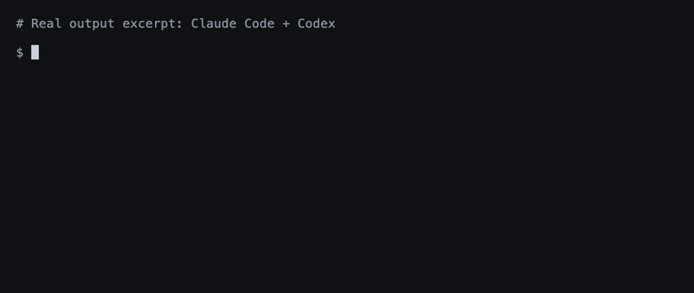

**Languages:** English | [简体中文](README.zh-CN.md)

# agentsync

**One command to share rules, skills, and MCP configs across your AI tools.**

Keep one copy across Claude Code, Codex, OpenCode, Gemini CLI, Antigravity, Qwen Code, Copilot CLI, Kimi Code, Grok CLI, Amp, Crush, Goose, Factory Droid, iFlow, Kilo, Pi, dsh, Cursor, Windsurf, Zed, CodeBuddy, Qoder, Junie, Kiro, JoyCode, and Aider Desk, plus the shared `~/.agents` entry. A lightweight standalone binary.

[](https://github.com/x0c/agentsync/actions/workflows/ci.yml) [](https://github.com/x0c/agentsync/releases/latest) [](LICENSE)



*A real Claude Code + Codex run; output excerpted for readability.*

> **Local-first by design:** 100% local execution · zero telemetry · dry-run preview (`agentsync --check`) · automatic backup snapshots with `agentsync --rollback latest`.

## Install

**Windows — PowerShell:**

```powershell
irm https://raw.githubusercontent.com/x0c/agentsync/main/install.ps1 | iex
```

**macOS / Linux — shell:**

```sh
curl -fsSL https://raw.githubusercontent.com/x0c/agentsync/main/install.sh | sh
```

The installers download the matching release archive (`agentsync_windows_<arch>.zip` on Windows, `agentsync_<os>_<arch>.tar.gz` on macOS/Linux) and verify its SHA-256 checksum before installing. `AGENTSYNC_INSTALL_DIR` overrides the default (`%LOCALAPPDATA%\Programs\agentsync\bin` on Windows, `~/.local/bin` on macOS/Linux); the Windows installer adds it to the user PATH.

**macOS / Linux — Homebrew:**

```sh
brew install --cask x0c/tap/agentsync
```

**Any OS — Go 1.25.8+:**

```sh
go install github.com/x0c/agentsync@latest
```

Add Go's bin directory to PATH if needed (usually `~/go/bin`; `%USERPROFILE%\go\bin` on Windows).

**Without an installer or Go:** download and extract a [release binary](https://github.com/x0c/agentsync/releases/latest), then put it on PATH. Available for macOS and Linux (arm64 / amd64), and Windows (arm64 / amd64). Checksums are included.

## Run

First preview, then apply:

```sh
agentsync --check
agentsync
```

That's it. `agentsync` merges your existing instructions, collects your skill folders, and imports your MCP servers into one shared source — then links or writes them back to each installed tool in its native format. Files replaced during sync are backed up automatically; tools you haven't installed are skipped.

From then on, maintain these files in `~/.config/agentsync/` (`%USERPROFILE%\.config\agentsync\` on Windows):

| File | What you manage once |
|---|---|
| `AGENTS.md` | Global instructions |
| `skills/` | Complete skill folders, including scripts and references |
| `mcp.json` | MCP servers |
| `instructions/` | Optional per-tool fragments such as `pi.md` |

Run `agentsync` again after changes, or use the optional watcher below.

## Optional commands

| Need | Command |
|---|---|
| Preview without writing | `agentsync --check` |
| Automatically apply source changes | `agentsync --watch` |
| Restore the latest backup | `agentsync --rollback latest` |
| Link a project's `CLAUDE.md` to its `AGENTS.md` | `agentsync --repo` |
| Install or remove owner-scoped skills (used by tool plugins) | `agentsync skill <install\|remove\|status>` |
| Print the version | `agentsync --version` |

See the [workflow guide](docs/AGENTSYNC_GUIDE.md) for background services, batch repository sync, filters, and backup details.

## Good to know

- Default sync manages **global configuration on this machine**. Project files are handled by the separate repository mode.
- Support varies by tool. See [instruction and skill support](docs/agent_runtime_global_paths.md) and [MCP support](docs/agent_runtime_mcp_paths.md).
- Instructions and skills use links where possible. Cursor gets a managed `.mdc` rule; Antigravity stays linked up to `22,000` bytes and automatically splits larger canonical `AGENTS.md` files into managed `~/.gemini/AGENTS.md` + `~/.gemini/config/rules/agentsync-part-*.md` parts (`trigger: always_on`) to avoid Antigravity's `24,000`-byte per-file truncation limit. On Windows, skill directories link as a symbolic link first, then an NTFS directory junction, otherwise agentsync reports an error naming Windows Developer Mode. See [Cursor loading limits](docs/AGENTSYNC_GUIDE.md#cursor-rules-visible-in-settings-but-absent-from-the-prompt).
- Exclude servers, skills, or instructions per tool with a `sync-policy.json` beside the canonical sources; see [filtering](docs/AGENTSYNC_GUIDE.md#global-synchronization). Filtering never removes content from the canonical source.
- Add rules for one tool only with `instructions/<runtime>.md` (for example `instructions/pi.md`): `agentsync` appends the fragment under a marked block and writes that runtime a managed copy instead of a link, so an extra restriction reaches only the tool that needs it. Tools without a fragment stay linked. Cursor keeps its `alwaysApply` frontmatter, and Windsurf reports a warning above its 6,000-character `global_rules.md` limit. See [per-tool instructions](docs/AGENTSYNC_GUIDE.md#per-tool-instruction-fragments).
- Edit the shared source. The watcher pushes changes out to your tools; it does not import edits made in another tool's settings. Keep `mcp.json` local: it may contain tokens and machine-specific paths. `.gitignore` / `.stignore` entries protecting `mcp.json` are written only when the configuration directory is already a Git repository (`.git`) or a Syncthing folder (`.stfolder`).
- Safety checks reject unsupported arguments, invalid MCP entries, and unsafe skill-directory overlaps. Your own rules are merged in before copies are generated; Codex servers that share a name keep their local restrictions and authentication options. Rollbacks use collision-resistant backup snapshots, and `latest` skips backups with no file changes. See the [preservation boundaries](docs/AGENTSYNC_KNOWLEDGE_BASE.md).

Questions or a missing tool? [Open an issue](https://github.com/x0c/agentsync/issues) with the tool name, OS, and redacted output. Contributor instructions: [AGENTS.md](AGENTS.md).

## FAQ

### How do I keep `CLAUDE.md`, `AGENTS.md`, skills, and MCP configs in sync across Claude Code, Cursor, Codex, and Windsurf?

Maintain one canonical source in `~/.config/agentsync/` (`AGENTS.md`, `skills/`, `mcp.json`, and optional `instructions/<runtime>.md`), preview changes with `agentsync --check`, and apply with `agentsync` or `agentsync --watch`. Inside a project repository, run `agentsync --repo` to link `CLAUDE.md` to `AGENTS.md`.

### Is `agentsync` safe to run on existing configs? Does it upload my `mcp.json` secrets?

Yes. `agentsync` executes 100% locally with zero telemetry and never uploads your configurations, rules, or MCP tokens. Every replaced file is saved to a collision-resistant backup snapshot that you can restore via `agentsync --rollback latest`, and `agentsync --check` previews changes without writing.

### How is `x0c/agentsync` different from manual symlinks?

Plain symlinks break when tools expect different file formats or enforce size limits. `agentsync` automatically generates Cursor `.mdc` rules with `alwaysApply`, splits Antigravity instructions above its 24 KB limit, handles Windows symbolic links or directory junctions, supports per-tool `instructions/<runtime>.md` fragments, and filters tools via `sync-policy.json`.

## 🧩 Related Tools in the AI Coding Suite

If you run multiple AI coding agents daily, check out the rest of the local-first toolkit:

| Repository | Description |
| :--- | :--- |
| **[corral](https://github.com/corral-dev/corral)** | Run Claude Code, Codex, OpenCode, Cursor & Pi side-by-side in a terminal session manager, then continue from iPhone or Mac. |
| **[subswap](https://github.com/x0c/subswap)** | Check remaining quota and switch Claude Code, Codex, Cursor, Kimi Code & OpenCode accounts without logging out. |
| **[agent-doc-skills](https://github.com/x0c/agent-doc-skills)** | Navigable project knowledge base skills (`doc-init`, `doc-update`, `doc-compact`) so coding agents don't rediscover your repo every session. |
| **[sesskit](https://github.com/x0c/sesskit)** | Parse and export local Claude Code, Codex CLI, and Cursor session transcript files from disk. |

## License

[MIT](LICENSE)
