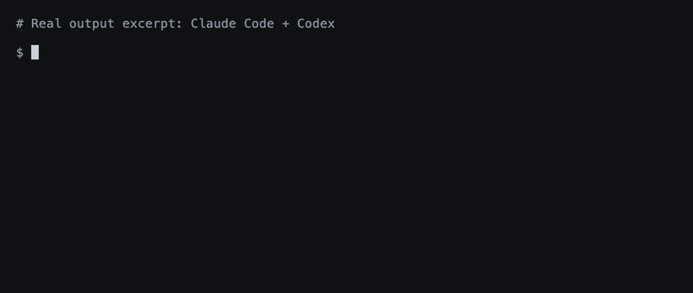

**语言：** [English](README.md) | 简体中文

# agentsync

**一条命令，统一管理 AI 工具的规则、Skills 和 MCP 配置。**

Claude Code、Codex、OpenCode、Gemini CLI、Antigravity、Qwen Code、Copilot CLI、Kimi Code、Grok CLI、Amp、Crush、Goose、Factory Droid、iFlow、Kilo、Pi、dsh、Cursor、Windsurf、Zed、CodeBuddy、Qoder、Junie、Kiro、JoyCode、Aider Desk 共 26 款工具，外加共享的 `~/.agents` 入口，本机只维护一份配置。轻量，单个可执行文件。

[](https://github.com/x0c/agentsync/actions/workflows/ci.yml) [](https://github.com/x0c/agentsync/releases/latest) [](LICENSE)



*Claude Code 与 Codex 的真实运行演示；为便于阅读，仅展示部分输出。*

## 安装

**Windows — PowerShell：**

```powershell
irm https://raw.githubusercontent.com/x0c/agentsync/main/install.ps1 | iex
```

**macOS / Linux — shell：**

```sh
curl -fsSL https://raw.githubusercontent.com/x0c/agentsync/main/install.sh | sh
```

安装脚本会下载匹配的 Release 压缩包（Windows 为 `agentsync_windows_<arch>.zip`，macOS/Linux 为 `agentsync_<os>_<arch>.tar.gz`），并在安装前校验 SHA-256。`AGENTSYNC_INSTALL_DIR` 可覆盖默认安装目录（Windows 默认为 `%LOCALAPPDATA%\Programs\agentsync\bin`，macOS/Linux 默认为 `~/.local/bin`）；Windows 安装脚本会将其加入用户 PATH。

**macOS / Linux — Homebrew：**

```sh
brew install --cask x0c/tap/agentsync
```

**任意系统 — Go 1.25.8+：**

```sh
go install github.com/x0c/agentsync@latest
```

如有需要，将 Go 的 bin 目录加入 PATH（通常为 `~/go/bin`；Windows 为 `%USERPROFILE%\go\bin`）。

**既不用安装脚本也不用 Go：** 下载并解压 [Release 中的可执行文件](https://github.com/x0c/agentsync/releases/latest)，放到 PATH 中即可。支持 macOS 和 Linux（arm64 / amd64），以及 Windows（arm64 / amd64），附带校验和文件。

## 使用

先预览，再执行：

```sh
agentsync --check
agentsync
```

就这一条。它会合并已有规则、收集完整的 Skill 文件夹，并导入 MCP 服务器配置，统一到一个共享目录，再为已安装的工具建立链接或写入对应格式的配置。替换前自动备份，未安装的工具自动跳过。

此后，只需维护 `~/.config/agentsync/`（Windows 为 `%USERPROFILE%\.config\agentsync\`）中的这三项：

| 文件 | 只维护一份的内容 |
|---|---|
| `AGENTS.md` | 全局规则 |
| `skills/` | 完整的 Skill 文件夹，包含脚本与参考资料 |
| `mcp.json` | MCP 服务器配置 |

修改后再运行一次 `agentsync`，也可以使用下方的自动同步。

## 按需使用

| 需求 | 命令 |
|---|---|
| 只预览，不修改文件 | `agentsync --check` |
| 自动同步共享目录中的改动 | `agentsync --watch` |
| 还原最近一次备份 | `agentsync --rollback latest` |
| 将项目的 `CLAUDE.md` 链接到 `AGENTS.md` | `agentsync --repo` |
| 查看版本号 | `agentsync --version` |

后台服务、批量同步仓库、按工具过滤与备份详情，见 [使用指南](docs/AGENTSYNC_GUIDE.md)。

## 几点说明

- 默认管理**本机的全局配置**；项目文件走独立的仓库模式。
- 各工具支持的能力不同，详见 [规则与 Skill 支持](docs/agent_runtime_global_paths.md) 和 [MCP 支持](docs/agent_runtime_mcp_paths.md)。
- 规则与 Skill 尽量使用链接；Cursor 会生成由 `agentsync` 托管的 `.mdc` 规则文件；Antigravity 在主规则不超过 `22,000` 字节时保持符号链接，超过后会自动按结构切分为受托管的 `~/.gemini/AGENTS.md` 与 `~/.gemini/config/rules/agentsync-part-*.md`（带 `trigger: always_on`），以避开 Antigravity 单文件 `24,000` 字节截断上限；Windows 下 Skill 目录优先建符号链接，其次用 NTFS 目录联接（junction），否则报错并提示开启 Windows 开发者模式。另见 [Cursor 规则加载限制](docs/AGENTSYNC_GUIDE.md#cursor-rules-visible-in-settings-but-absent-from-the-prompt)。
- 可用 canonical 目录旁的 `sync-policy.json` 按工具过滤服务器、Skill 或规则，详见 [过滤配置](docs/AGENTSYNC_GUIDE.md#global-synchronization)。过滤不会删除源文件中的内容。
- 请修改共享目录中的源文件。自动同步只向各工具写入，不会导入工具设置界面的改动。`mcp.json` 可能含令牌与本机路径，请保留在本机。仅当配置目录已经是 Git 仓库（含 `.git`）或 Syncthing 文件夹（含 `.stfolder`）时，才会写入保护 `mcp.json` 的 `.gitignore` / `.stignore` 条目。
- 安全检查会拒绝不支持的参数、无效 MCP 条目和不安全的 Skill 目录重叠。生成副本前先合入用户自写的个性化规则；同名的 Codex 服务器保留各自的本地限制与认证配置。回滚机制采用防冲突的独立备份快照，且 `--rollback latest` 会自动跳过无文件变更的空记录。详见 [内容保留边界](docs/AGENTSYNC_KNOWLEDGE_BASE.md)。

遇到问题或希望支持新工具？[提交 Issue](https://github.com/x0c/agentsync/issues)，附上工具名称、系统和脱敏输出。贡献规范见 [AGENTS.md](AGENTS.md)。

## 🧩 AI 编程工具链里的相关工具

如果你每天在多个 AI 编程助手之间切换，看看这套本地优先工具链的其余部分：

| 仓库 | 说明 |
| :--- | :--- |
| **[corral](https://github.com/corral-dev/corral)** | 在终端会话管理器里并排跑 Claude Code、Codex、OpenCode、Cursor 和 Pi，再从 iPhone 或 Mac 上继续。 |
| **[subswap](https://github.com/x0c/subswap)** | 查剩余额度，一键切换 Claude Code、Codex、Cursor、Kimi Code 和 OpenCode 的账号，不用反复登录。 |
| **[agent-doc-skills](https://github.com/x0c/agent-doc-skills)** | 可导航的项目知识库 skills（`doc-init`、`doc-update`、`doc-compact`），让 coding agent 不再每个会话都重新认识你的仓库。 |
| **[sesskit](https://github.com/x0c/sesskit)** | 从磁盘解析、导出本地 Claude Code、Codex CLI 和 Cursor 会话记录文件。 |

## 许可证

[MIT](LICENSE)
