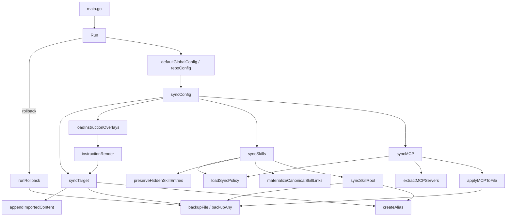

# Synchronization knowledge base

This document owns synchronization mechanisms and preservation boundaries. [Repository instructions](../AGENTS.md) own contribution rules; the [workflow guide](AGENTSYNC_GUIDE.md) owns commands, report states, validation, and releases.

## Ownership and architecture

Canonical instructions (`AGENTS.md`), complete skill directories (`skills/`), MCP definitions (`mcp.json`), and optional policy (`sync-policy.json`) live under `~/.config/agentsync/`. Runtime entries expose that content in each tool's format. Canonical content remains complete; policy changes only the view written to a runtime.

`Detect` is each runtime's installation directory. A nonempty, absent `Detect` path must return `skipped` before any write. Use the runtime home rather than its skill subdirectory: an installed runtime may not have created its skill directory yet. In particular, do not create JoyCode's home merely to write MCP configuration, because doing so can interfere with the runtime's legacy migration.

## Instructions and aliases

When the canonical source is missing, readable runtime entries can initialize it. Each installed target then follows the `syncTarget()` state machine: absent targets are created, correct links report `ok`, and broken/wrong links or differing files are repaired according to check/apply mode.

Preserve unique user-written content before replacement by importing it; back up replaced entries. Reviewed replacement content can be prepared manually and adopted with `--adopt`; the current synchronization path does not generate merge drafts automatically. Ordinary differing files merge by default. `--force` permits direct replacement after backup and must not become the default.

Files marked `<!-- managed-by: agentsync` are generated copies, including Cursor `.mdc` rules and multi-part Antigravity split rules (`~/.gemini/AGENTS.md` when split plus `~/.gemini/config/rules/agentsync-part-*.md`). If stale or shrunk, replace or prune them from the canonical source; never import their old body back into it. Destination format alone does not establish ownership: preserve unique unmarked Cursor/Antigravity files and linked user content before replacing them. Finish instruction imports before generating any runtime copies, so later targets cannot leave earlier copies stale. `sameContent()` strips managed markers and Cursor frontmatter; Antigravity checks part hashes against canonical chunks. An equivalent ordinary file reports `ok` unless forced.

Per-runtime fragments in `instructions/<runtime>.md` extend the source after imports. `loadInstructionOverlays()` maps each case-insensitive runtime key to one fragment, warns about unknown names, rejects duplicate keys, and treats a blank fragment as absent; loading runs before any write, so a bad fragment cannot leave a half-updated source. `instructionRender` appends the fragment under `<!-- agentsync:begin overlay target="..." -->` / `<!-- agentsync:end overlay -->` markers, and the managed header records `overlay="<runtime>"` plus a SHA-256 hash of the rendered body (Antigravity split files add `part=`/`total=` to the same line), so changing either input refreshes the copy. A target with a fragment is never a symlink; its copy is compared with `samePayload()` and refreshed without importing its body. When the fragment disappears, only a copy carrying that `overlay=` marker is restored to a plain alias, which leaves Windows link-fallback copies and legacy managed copies alone. Writes go through `writeFileAtomic`, and imports read through `importablePayload()`, which removes generated overlay sections so copying a generated file can never spread fragment text into the source or another runtime. Repository and batch modes leave `InstructionOverlayDir` empty, so global fragments never reach project files. Fragment size limits belong to the runtime: Windsurf's 6,000-character `memories/global_rules.md` cap produces a `warning` (the marker header counts), and Antigravity still splits merged bodies above `22,000` bytes.

File alias fallback order is symlink, Windows hardlink, then managed copy. Directory aliases (skill roots) never fall back to a static copy: on Windows they try a symbolic link, then an NTFS directory junction, then fail with Developer Mode guidance; off Windows a symlink failure for a directory is returned directly. Global links use absolute resolved paths.

Windows directory aliases (skill roots) use a symlink-then-junction fallback, implemented in `createDirAlias` (`files.go`) and verified on Windows with Developer Mode both on and off: when symbolic-link creation is not permitted (Developer Mode off, not elevated), the alias is created as an NTFS directory junction instead of failing, and only when the junction also fails does it return the shared `developerModeError` (`link.go`), which names Developer Mode with `start ms-settings:developers` and notes the NTFS requirement. There is never a silent static copy for directories. Since Go 1.23, `os.Lstat` reports a junction as `ModeIrregular` rather than `ModeSymlink` ([Go change](https://go.googlesource.com/go/+/cb6d15a747ee7875504fdb4fc28c64c67c5f8d82/doc/next/6-stdlib/99-minor/os/61893.md)), so the shared `isManagedLink` recognizer covers both, and every alias check, replacement, backup, rollback, watch and overlap decision uses it together with `linkPointsTo` (`os.Readlink` resolves junction reparse points on Windows). Replacing or removing a junction uses `os.Remove`, never touching its target's contents; backups record junctions as kind `junction` with the link-target string as payload, and rollback recreates them via `junctionCreateFunc`. The report detail for a created junction alias is `junction`, and an already-correct junction reports `ok` with `skill directory junction`. Limits: junctions apply only on Windows and only to directories, and require an NTFS volume; non-NTFS volumes (FAT32/exFAT, some network shares) fail, yielding the Developer Mode error. The `symlinkCreateFunc`/`junctionCreateFunc` seams let every OS's CI verify the fallback order and the no-static-copy guarantee; Windows-only tests create real junctions. Repository mode uses a relative `CLAUDE.md -> AGENTS.md` link so moving a checkout remains safe. Cursor is an explicit exception to bare aliases: its managed `.mdc` requires `alwaysApply` frontmatter.

Known defect (confirmed 2026-11-01 with the published 1.1.0 on Windows 11, Developer Mode off; also present in earlier releases): when an instruction alias falls back to a Windows hardlink and an editor saves the canonical `AGENTS.md` by writing a new file and renaming it over the old one, the runtime file keeps the previous content as an independent file. The next run then treats that stale copy as unique user content and appends it to the canonical source as an `Imported From` block, so every such save adds stale text. Backups keep the data recoverable; nothing is lost. Symlinks (macOS, Linux, Windows with Developer Mode) and marked managed copies are not affected, because a managed copy's marker identifies it as generated. Proposed fix, pending an owner decision: on Windows, fall back from a refused symlink to a marked managed copy rather than a hardlink (the watcher keeps copies fresh), or otherwise recognize a former hardlink of the canonical file before importing.

Repository and batch modes manage only repository instruction entries. They must not modify global instructions, skills, or MCP configuration.

## Skills

`syncSkills()` discovers directories containing `SKILL.md`, preserves hidden runtime content such as `.system`, materializes ordinary skill symlinks in the canonical source into real directories, and imports missing skills before replacing runtime roots.

Without effective policy filtering, a runtime skill root aliases the entire canonical root. This makes additions, deletions, and renames visible immediately. With filtering, it becomes a real directory containing symlinks only for allowed skills, plus preserved hidden directories. Removing filtering restores the whole-root alias after backup. Always creating individual skill links would reintroduce stale deletions and renames.

Hidden directories are excluded from ordinary skill discovery but retained by `preserveHiddenSkillEntries()`. They also participate in watch fingerprints. Never treat all dot-directories as disposable.

Skill materialization must use a uniquely created staging directory and clean up only its own staging content; a pre-existing `<skill>.agentsync-tmp` directory is user content, not disposable storage. Resolve the complete root symlink chain before copying a skill. Before replacing a runtime root, compare resolved source/target identities and ancestry: never delete the canonical source's backing directory or create an alias cycle. Unsafe overlaps must fail without removing either tree.

### Known filtering limitations

- Codex can discover skills through both its own skill root and `~/.agents/skills`. Filtering only the Codex target does not hide a skill available through the shared root. To disable it in Codex, also set `[[skills.config]]` with `name = "<skill>"` and `enabled = false` in Codex configuration. Name-based disabling was verified with Codex 0.159; verify the installed version before changing this workaround.
- `materializeFilteredSkillRoot()` copies hidden directories only when absent. Existing filtered-root `.system` content is a snapshot, not a continuously refreshed canonical view. Updating canonical hidden content currently requires synchronizing that copy separately; preserve any runtime-owned changes when doing so.

Follow-up: support Codex name-based disable entries through a safe key merge, and reconcile hidden-copy updates without discarding runtime changes. These are recorded limitations, not implemented features.

## MCP

Global synchronization injects the English canonical-source notice into `AGENTS.md` before exposing it to runtimes. If `mcp.json` is absent, installed runtime configurations initialize it through a case-insensitive server-name union; the first encountered definition wins. Policy does not affect this import.

For each installed target, apply name-based policy, exclude runtime-specific bundled servers where necessary, translate its dialect, and compare the resulting server set semantically. An equivalent set reports `ok` without rewriting a hot configuration file. Filtered names can appear in the detail.

Dedicated MCP files can be replaced. Mixed files must preserve unrelated authentication, trust, settings, and state by changing only the MCP key. Codex TOML handling must understand commented table headers and literal dots in quoted server names. Preserve same-name Codex server-local disablement, tool restrictions, approval and authentication settings when managed connection fields change; removed canonical servers still disappear. Do not propagate runtime-local permissions into other runtimes. Use atomic writes in the same directory and account for concurrent runtime writes. Never apply whole-file instruction symlinks to mixed MCP configuration.

New canonical MCP files use `0600`. Preserve existing target permissions. Configuration may contain plaintext tokens and private URLs: keep canonical MCP, backups, and merge drafts out of Git and Syncthing. When the canonical root has `.git` or `.stfolder`, `ensureSecretIgnores()` adds `mcp.json`, `backups/`, and `merge-drafts/` to the corresponding ignore file. Policy contains no tokens and can be synchronized separately.

Empty files, malformed JSON, a missing `mcpServers` object, or any invalid canonical server entry fail without overwriting MCP targets. Reject partially valid sets rather than silently turning invalid entries into server deletions. Watch also rejects an empty map if installed runtimes still have servers; intentional clearing requires a one-shot apply. Infer imported transport using the source dialect: Gemini/Qwen `url` is SSE and `httpUrl` is streamable HTTP.

Codex bundled local servers identified by `SkyComputerUseClient`, `node_repl`, or `NODE_REPL_*` remain in the canonical source for Codex round trips, but are not copied to other runtimes. Crush command substitution, including both `$()` and backquote forms, must be rejected, not passed through. iFlow and the shared `~/.agents` entry have no MCP output.

The [MCP path/format guide](agent_runtime_mcp_paths.md) owns dialect rules and runtime-specific detection. Pi retains policy key `pi`; `piMCP` selects `auto`, `native`, or `adapter`. Native writes preserve top-level settings and per-server `exposure`, `toolExposure`, `oauth`, `timeout`, and `enabled`; removed servers still disappear. Adapter-owned files are not renamed or rewritten as native configuration.

## Policy

`sync-policy.json` is separate from MCP secrets. Match runtime and server/skill names case-insensitively. Deny wins; a nonempty target allowlist applies next; otherwise use the section default (`allow` when omitted). Unknown runtime names warn rather than fail. Denied servers disappear from the written set rather than being emitted as disabled entries.

A missing policy preserves the unfiltered behavior. Reject target keys that collide after case folding, in both MCP and skill policy, so an exact-match object cannot hide a case-equivalent deny rule. The canonical source always remains complete. Changes to policy semantics require aligned documentation and tests.

## Watch

The watcher tracks canonical sources, policy, runtime presence, Pi selection, and the per-runtime fragment directory. Do not monitor runtime output files such as `~/.claude.json`: that creates write loops. Runtime-side MCP edits are not automatically imported.

Instruction/skill-only changes with an unchanged policy set internal `Options.SkipMCP`. Policy changes must update both skills and MCP. `SkipMCP` is not a public CLI flag.

Only a successful `runOnce()` advances the successful fingerprint. Never mark an input version as applied when derived outputs were generated from an earlier version; source imports and concurrent source changes must not be swallowed by a post-run snapshot. Failed writes, blocked targets, and invalid source content must be retried; a printed `blocked` result is an operational failure, not successful synchronization. Ignore Syncthing conflict files, `.DS_Store`, and `.stversions`, but include `.system`; exclude directory mtimes so ignored files cannot trigger updates. Watch remains opt-in, incompatible with forced replacement, and configured through the service templates rather than a service-install subcommand.

## Backups and rollback

File copies and instruction imports must close each opened file exactly once and propagate close failures along with any earlier write/copy error. Otherwise a failed final write can be reported as successful preservation. Watch fingerprint writes must also propagate errors instead of silently advancing. The Go contracts for [File.Close](https://pkg.go.dev/os#File.Close) and [errors.Join](https://pkg.go.dev/errors#Join) support single-close handling while retaining multiple errors.

A real synchronization uses `beginBackupSession()` / `endBackupSession()`. Replaced paths share one unique timestamp directory containing payloads and `manifest.json`, with original absolute paths and file/symlink/junction/directory types. Payload names must be collision-resistant for distinct original paths, including paths differing only by separators versus literal underscores. Preserve compatibility with existing manifest payload names. Same-second sessions receive suffixes such as `-01`; reusing a stamp could overwrite the payload currently being restored. Empty successful sessions must not hide the latest recoverable nonempty backup.

Rollback supports read-only preview, backs up current entries according to their current filesystem type before restoring the saved type, and does not call synchronization afterward. A skill symlink materialized into a directory must remain reversible; preview must not approve an inherently impossible restore path. `latest` selects the newest valid nonempty manifest, skipping no-op sessions. Old stamps without a manifest require manual restoration. Reject manifests that share a payload across different originals: already-overwritten legacy payloads cannot be reconstructed by a new release. Backups cover replaced entries in that session, not the entire machine.

## Implementation anchors

| File | Responsibility |
|---|---|
| `main.go`, `types.go` | Flags, options, configuration, and report types |
| `run.go` | Dispatch, instruction state machine, batch scanning, reports |
| `instructions.go` | Per-runtime fragment loading, overlay rendering, runtime size warnings |
| `paths.go` | Canonical sources, runtime targets, repository configuration, path expansion |
| `files.go` | Aliases, managed copies, payload comparison, file/directory preservation |
| `antigravity.go` | Structural rule splitting (`>22,000` B) across `~/.gemini/AGENTS.md` and `~/.gemini/config/rules/agentsync-part-*.md` |
| `link.go`, `junction_windows.go`, `junction_other.go` | Managed-link recognition, directory-alias order, Developer Mode error, NTFS junctions |
| `merge.go` | Source initialization, unique-content imports, reviewed-file adoption |
| `skills.go`, `policy.go` | Skill discovery/import, hidden content, filtered views, policy evaluation |
| `mcp.go`, `mcp_extract.go`, `mcp_server.go`, `mcp_validate.go`, `mcp_json.go` | Source import, strict canonical validation, semantic comparison, MCP normalization, secret ignores |
| `mcp_render.go`, `mcp_apply.go`, `mcp_toml.go` | Dialect rendering, syntax-aware Codex TOML updates, and runtime-local option preservation |
| `mcp_dsh.go`, `pi_mcp.go` | dsh managed patches and Pi output selection |
| `watch.go` | Polling, fingerprints, debounce, retries |
| `backup_session.go`, `restore.go` | Session manifests and rollback |

Paths other than `main.go` are under `internal/agentsync/`. Matching `_test.go` files exercise preservation, isolation, rollback, policy, idempotency, and dialect edge cases. Use the code graph for call relationships rather than duplicating a complete symbol inventory here.

## Verification boundaries

Release builds use the patched Go 1.26.10 toolchain recommended by `go.mod`; the minimum supported Go 1.25 patch is 1.25.8. The October 2026 review's `govulncheck` run on Go 1.25.6 reported [GO-2026-4602](https://pkg.go.dev/vuln/GO-2026-4602) through `os.ReadDir`. The documented exploit requires `os.Root` (not used here), so the trace alone does not establish an exploitable AgentSync path; nevertheless build and scan the shipped binary with the fixed toolchain rather than suppressing the diagnostic. See [Go patch release notes](https://go.dev/doc/devel/release).

The [workflow guide](AGENTSYNC_GUIDE.md#development-validation) owns local commands and real-path smoke expectations. MCP tests additionally cover absent runtimes, malformed/empty sources preserving outputs, policy filtering, mixed-file state preservation, and watch's empty-map protection. Skill tests must cover hidden content and transitions between filtered and whole-root views.

A synchronized file proves filesystem behavior, not runtime prompt loading, approval, OAuth, or remote connectivity. Cursor injection and native Pi sign-in require their own runtime acceptance. Historical upstream observations in the path guides are version-specific; consult current official documentation before changing implementation contracts.
